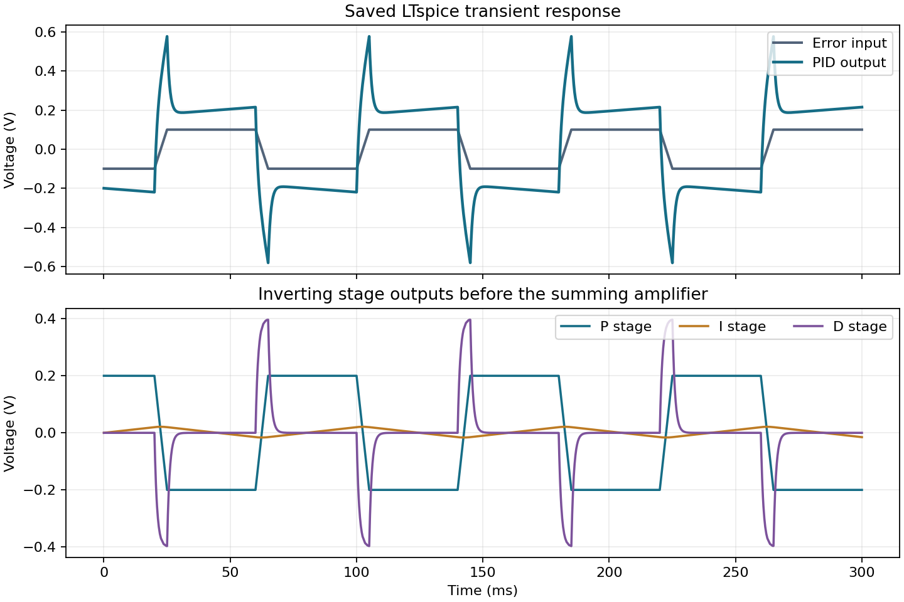
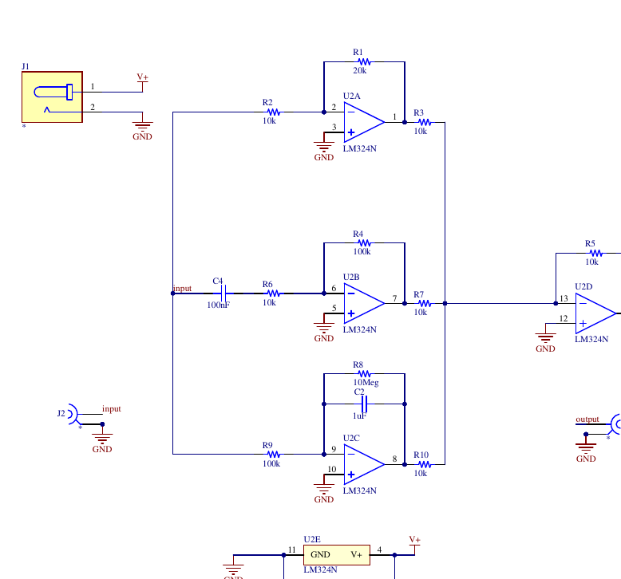
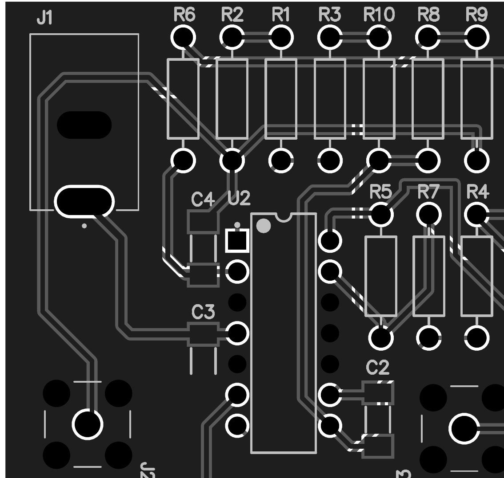

# Analog PID Controller & PCB Design

Analog Electronics Laboratory II course project at Sharif University of Technology. The project implements the proportional, integral and derivative terms of a PID controller using operational amplifiers, then translates the circuit into an Altium Designer schematic and PCB layout.

**Tools:** LTspice XVII, Altium Designer, LM324N quad operational amplifier (PCB schematic).

## Design architecture

The error input is applied to three parallel inverting op-amp stages. A fourth inverting amplifier sums their outputs, restoring the overall sign. The circuit is a standalone controller driven by a test error signal, not a closed-loop plant model.

| Stage | Component values in the LTspice design | Function |
|---|---|---|
| Proportional | Input 10 kΩ, feedback 20 kΩ | Inverting gain of −2 |
| Integral | Input 100 kΩ, feedback 1 µF in parallel with 10 MΩ | Practical (leaky) integrator; nominal integral coefficient 10 s⁻¹ in its integrating region |
| Derivative | Input 100 nF in series with 10 kΩ; feedback 100 kΩ | Band-limited differentiator; nominal derivative coefficient 0.01 s at low frequency |
| Summing | Three 10 kΩ input resistors and 10 kΩ feedback | Inverting unity-weight summation |

The integrator feedback resistor limits the DC gain; the series input resistor of the differentiator limits high-frequency gain. These coefficients describe the idealized circuit's design regions, not fitted closed-loop tuning parameters.

## Simulation

[LTspice schematic](ltspice/project.asc) uses four UniversalOpamp2 models with ±15 V rails. The pulse source switches between −100 mV and +100 mV, with a 20 ms initial delay, 5 ms rise and fall times, 35 ms pulse width and 80 ms period. The transient command runs for 300 ms with a specified maximum step of 10 µs.



### Saved transient results

The table below is calculated from the 326 points stored in the original LTspice RAW file (not from a new simulation). Stage values refer to the inverting blocks before final summation.

| Signal | Minimum (V) | Maximum (V) |
|---|---:|---:|
| Error input | -0.1000 | 0.1000 |
| P stage | -0.2000 | 0.2000 |
| I stage | -0.0163 | 0.0212 |
| D stage | -0.3970 | 0.3968 |
| Controller output | -0.5817 | 0.5770 |

The proportional stage follows the expected inverting gain of two; the integral stage accumulates the input over time, and the derivative stage responds strongly to the pulse transitions. The saved output is consistent with the negative sum of the three stage voltages (within approximately 30 µV at the saved points).

- [Original LTspice waveform](results/project.raw)
- [Exported transient data (CSV)](results/transient.csv)

The plot and CSV were created from the original RAW file for this repository. The saved waveform uses automatically generated LTspice node names; the traces were identified from the schematic and checked against the proportional and summing relationships. Values refer to the available stored points, not necessarily every solver step.

## Schematic and PCB layout

The Altium design uses an LM324N quad op-amp, ten resistors, three capacitors (including a supply bypass capacitor), and power/input/output connectors. The project contains the editable schematic and board files as well as the original two-page Altium PDF export.





[Original schematic and PCB PDF export](documentation/design-export.pdf)

## Repository structure

```text
ltspice/          Original LTspice schematic
altium/           Original project, schematic and PCB files
documentation/    Original Altium PDF export
figures/          Schematic, PCB and waveform previews
results/          Original saved RAW waveform and extracted CSV
```

## How to open the project

1. Open `ltspice/project.asc` in LTspice and run the transient analysis. Probe the error input, each op-amp stage and the final summing amplifier output. Alternatively, open `results/project.raw` to inspect the original stored waveform.
2. Open `altium/Sharif_EE2LAB_Project.PrjPcb` in Altium Designer. The existing `.SchDoc` and `.PcbDoc` can also be opened directly.
3. The original project references `Library/Schlib.SchLib` and `Library/PCBLIB.PcbLib`, which were not present in the submitted archive. Those libraries may be required for component editing, library updates or project validation. An external title-block image is also missing; the PDF export displays a missing-file notice.

## Design limitations and verification status

- The LTspice design uses split ±15 V rails, whereas the Altium schematic connects the LM324N negative supply to ground and uses a single positive rail. The bipolar test waveform and the inverting stages cannot be assumed to work unchanged in this single-supply implementation. A compatible split supply or a properly designed bias/reference network and a simulation with the actual LM324N model are needed before claiming equivalent hardware behavior.
- The saved LTspice output documents simulation of the controller only. No physical PCB fabrication, hardware test, DRC result or Gerber manufacturing package was supplied. The original design files have been preserved; Altium compilation, DRC and a new LTspice simulation have not been performed as part of repository preparation.

## Author

Aynaz Rezaeizadeh — Electrical Engineering, Digital Systems, Sharif University of Technology.
